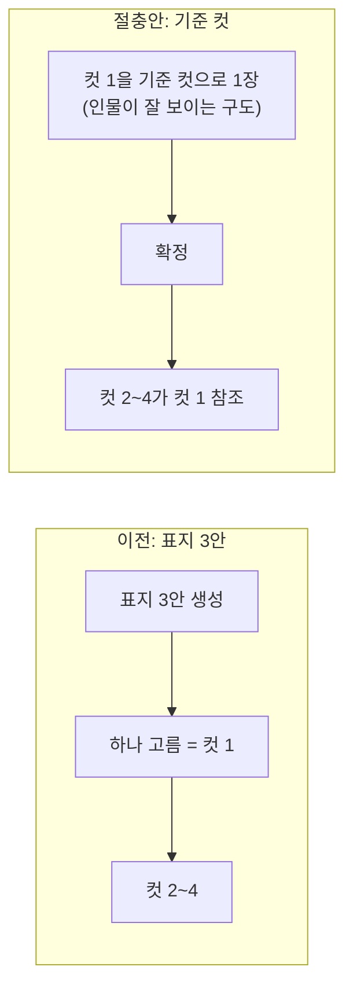
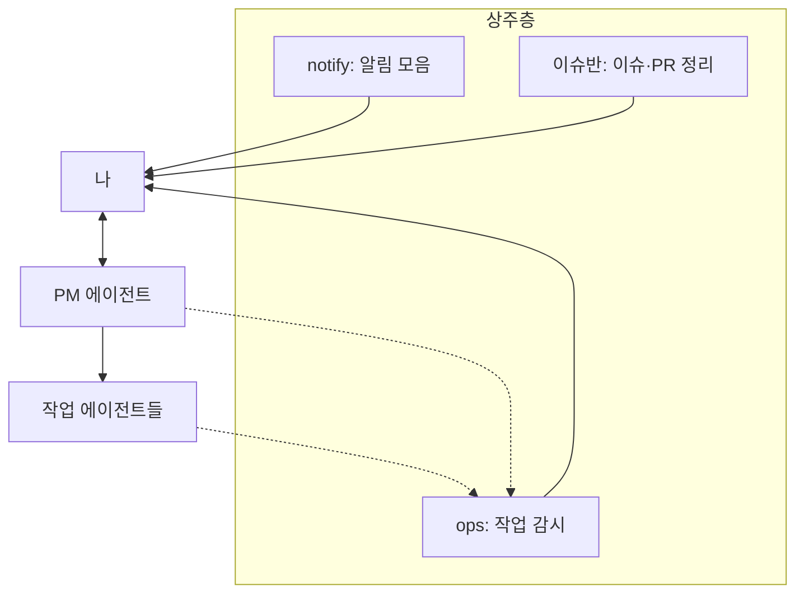

+++
title = "작업은 에이전트가 했고, 협업은 사람이 했다: 컷툰 해커톤 2차 회고"
date = "2026-10-15T12:27:00+09:00"
draft = false
tags = ["hackathon", "ai-agent", "multi-agent", "collaboration", "claude-code", "opencode", "회고"]
categories = ["일지"]
description = "2차 해커톤도 코드는 거의 에이전트가 짰다. 근데 회고 인터뷰를 하고 나서 글로 남기고 싶었던 건 사람 얘기였다. 리뷰어를 돌린 일, 결정을 내려놓은 일, 그리고 나한테도 가드레일을 건 일."
+++

# 작업은 에이전트가 했고, 협업은 사람이 했다

> 에이전트를 몇 개를 띄우든, 이슈에 이름 걸고 답하는 건 결국 사람 넷이었다.

---

## 들어가며

컷툰 제작 AI 코파일럿 해커톤 2차 스프린트가 끝났다. 09-30부터 10-15까지, 팀원 넷이 각자 에이전트를 붙여서 일했다. 5일짜리였던 1차 이야기는 [1편](/blog/agents-talked-through-github-issues/)이랑 [2편](/blog/rules-came-from-corrections/)에 적어 뒀다.

이번에도 코드는 거의 에이전트가 짰다. 내 스폰 원장만 봐도 대충 규모가 나온다.

| 도구 | 스폰 원장 행 |
|---|---|
| OpenCode | 약 121 |
| Claude Code | 37 (그중 Opus 약 20) |
| Codex | 24 |

한 행에 여러 건을 묶어 적은 것도 있어서 실제로 띄운 수는 이것보다 많다. 팀원들이 각자 띄운 건 아예 안 들어가 있다.

마감 직전에 회고 인터뷰를 했다.

<figure></figure>

에이전트 하나를 인터뷰어로 띄우고, 그동안 쌓아 둔 원장(스폰·마찰·잘된 지점 기록)을 질문 재료로 넘겼다. 질문은 거의 에이전트 운영 쪽이었다. 검증을 얼마나 세게 걸었는지, 리드 에이전트는 왜 바꿨는지, 비용은 어땠는지.

근데 다 끝나고 "이 중에 글로 쓸 만한 게 뭐냐"는 질문에 내가 고른 건 팀 운영 질문이었다.

> ai 에이전트로 모두 작업을 했지만 실제 작업자는 사람이고 사람들과의 협업 마음가짐과 분업 체제는 여전히 중요한 역할을 한다는 그런 부분?

그래서 이 글은 그 얘기다.

---

## 1. 분업: 컨텍스트를 혼자 다 끌어안지 않기

팀은 영역별로 나뉘어 있었다. 화면 전체, 이미지 생성·추출, 렌더링·QA. 나는 스키마·데이터 계약·LLM·백엔드를 맡으면서 PM을 겸했다.

인터뷰에서 팀 프로젝트라서 좋았던 점을 물었을 때 이렇게 답했다.

> 확실히 스코프가 나누어져서 선택과 집중이 잘 되었다는 거야. 한마디로 모든 컨텍스트를 다 끌어 안고 있지 않기 때문에 각자의 스코프 관점에서 서로의 코드, 산출물을 상호보완하는 관계가 이루어진 거지.

사실 에이전트를 쓰면 혼자서도 전 영역을 다 만질 수 있다. 손이 모자라서 막힌 적은 거의 없었다. 그러니까 분업이 좋았던 건 일을 나눠서 빨리 끝내서라기보다, 다른 자리에 앉은 사람이 같은 걸 다른 눈으로 봐 줬기 때문이었다.

### PR 리뷰어를 분산시켜보기

<figure></figure>

2차 초반에 PR 리뷰어 지정을 일부러 바꿨다. 나한테 걸려 있던 리뷰는 다른 팀원한테 교차로 넘기고, 내 PR에도 여러 사람을 걸었다.

솔직히 이유는 단순했다. 짐을 좀 덜고 싶었다. 1차 때는 리뷰든 결정이든 거의 다 나를 거쳐 갔고, 그걸 2차까지 혼자 지고 가고 싶지는 않았다.

근데 의외로 부가효과가 더 컸다. 화면 담당은 화면 쪽 관점에서 이미지 코드를 보고, 이미지 담당은 이미지 쪽 관점에서 렌더링 코드를 보게 되니까, 작성자 혼자서는 안 보이던 게 걸리기 시작했다. 짐 나누려고 한 일이 교차검증이 돼 버린 거다.

예를 들면 내가 올린 흐름 다이어그램 PR([#309](https://github.com/chictimin/cuttoon-copilot/pull/309))을 이미지 담당이 리뷰했는데, 이미지 쪽 코드랑 대조해 보니 생성·추출 API가 엉뚱한 레인에 그려져 있었다. 업로드가 추출을 부르는 것처럼 화살표도 잘못 이어져 있었다. 실제로는 화면이 업로드 결과를 받아서 추출을 차례로 부르는 구조다. 내 에이전트는 문서 전체를 보고 그렸지만, 그 레인의 실제 호출 순서를 매일 만지는 사람은 이미지 담당이었으니까.

리뷰가 아예 일을 가져가는 쪽으로 이어진 적도 있다. 화면 담당이 내 PR([#301](https://github.com/chictimin/cuttoon-copilot/pull/301))을 리뷰하다가 같은 함수가 화면 파일 두 곳에 복제돼 있는 걸 짚었고, 머지되면 그 정리는 자기가 하겠다고 했다. 그리고 다음 PR([#303](https://github.com/chictimin/cuttoon-copilot/pull/303))로 진짜 합쳤다. 내가 시킨 일이 아니었다.

### 내 에이전트가 낸 결론을 팀원 데이터가 뒤집었다

비슷한 일이 이슈 코멘트에서도 있었다. 컷 연출 기능을 POC로 돌려 보던 날, 내 테스트 세션 두 개에서 컷 사이에 인물 피부색이 빠지는 문제가 나왔다. 거의 동시에 이미지 담당 쪽에서도 같은 문제를 보고했는데, 그쪽은 "참고 그림이 붙으면 인물이 흔들린다"는 가설을 세우고 있었다.

나는 내 에이전트가 읽어 준 대로 답했다. 내 세션 두 개는 둘 다 참고 그림이 없는 프로젝트였으니까, 참고 그림 말고 다른 변수도 봐야 하지 않겠냐고. 그때였다.

<figure><figcaption>물론 이렇게 드라마틱한 상황은 아니었다</figcaption></figure>

이미지 담당은 반박하는 대신 실험 전에 하나만 맞춰 보자고 했다. 자기 로컬에서 같은 프로젝트 프리셋을 조회해 보니 참고 그림이 1장씩 있다는 거였다.

다시 확인해 보니 팀원 말이 맞았다. 에이전트가 프리셋 데이터에서 참고 그림 필드 위치를 잘못 읽었던 거다. 그래서 "참고 그림 없이도 피부색이 빠진다"는 결론은 [정정 코멘트](https://github.com/chictimin/cuttoon-copilot/issues/326#issuecomment-6119188731)로 철회했고, 그 뒤 실험은 팀원 가설 쪽으로 정리됐다.

이게 무서운 게, 내 쪽에서 보면 아무 이상이 없어 보였다는 거다. 내 에이전트는 내 질문에 맞는 답을 줬고, 나는 그걸 의심할 이유가 딱히 없었다. 결국 그걸 잡은 건 같은 데이터를 다른 자리에서 들여다본 사람이었다.

### 같은 결과물을 네 군데서 봤다

[#325](https://github.com/chictimin/cuttoon-copilot/issues/325) 진행 과정을 다시 보면, POC 하나를 놓고 영역마다 의견이 따로 달렸다.

<figure></figure>

| 영역 | 본 것 |
|---|---|
| 화면 | 단계 분리가 지금 구조에서 자연스러운지, "고른 그림이 4컷 안에 없다"는 사용자 기대 문제 |
| 이미지 | 참고 그림 끌림, 모드별 비교 실험 |
| 렌더링·QA | 기준 컷이 파일 순서·꼬리 처리에 주는 영향 |
| PM(나) | 절충안 정리, 진행 방식(프리 버전 브랜치 → main) |

화면 담당이 짚은 "고른 그림이 결과에 없다"는 이미지 쪽에서는 안 보이는 문제다.
반대로 참고 그림 끌림은 화면 코드를 아무리 읽어도 안 보이고. 최종 절충안(컷 1을 기준 컷으로)은 이 두 걱정을 한 번에 푸는 자리에서 나왔다.

기본으로 그리는 이미지는 6장에서 4장으로 줄었고, 마음에 안 들면 사용자가 컷 1만 다시 만들면 된다.

---

## 2. 결정을 내려놓기

### 1차에서 느꼈던 부담과 압박감을 내려야 했다

<figure></figure>

이 얘기는 1차부터 해야 한다. [1차 회고](/blog/agents-talked-through-github-issues/)에도 적었지만, 그때 팀원 대부분이 git 자체를 거의 안 써 본 상태였다. 그 상태로 협업을 굴리려면 누군가는 방향을 잡아야 했고, 개발자 출신인 내가 잡는 게 맞긴 했다.

문제는 방향만 온 게 아니었다는 거다. 결정권이고 기능 방향성이고 전부 나한테 몰렸다. 팀원들이 자기 판단이나 자기 에이전트 코딩 실력으로 충분히 풀 수 있는 일이라 생각한 것들도 나를 거쳐 갔다.

1차가 거의 끝나 갈 즈음 이런 생각까지 닿았다(물론 과한 억측이고 우려라는 건 안다).
내가 이 사람들을 팀원이 아니라 일 시키는 또 다른 에이전트들처럼 여기고 있는 건 아닐까. 그래서 2차에서는 이걸 그대로 가져가지 말자고 마음먹고 시작했다.

### 근데 그건 내 머릿속에만 있었다

그렇게 시작했는데, 내가 마음 속으로만 결정한 걸 그 누가 알겠는가?

PM 에이전트는 하던 대로 했다. 결정할 거리를 다 모아서 나한테 가져오고, 스스로 권고까지 붙여서 결론을 맺은 채 보고했다. 팀 코멘트 초안에는 범위가 다 정해져 있었고 담당까지 배정돼 있었다. 그걸 보고 아, 이건 내가 생각한 방향이 아닌데 싶었다.

<figure><figcaption>클로드 입장에서는 억울했을 거다</figcaption></figure>

근데 생각해 보면 당연한 거였다. 바꾸겠다는 건 내 머릿속에만 있었고 행동은 예전 그대로였으니까, 에이전트가 알 방법이 없었다. [1차 2편](/blog/rules-came-from-corrections/)에서 "에이전트가 모르는 맥락이 있었다"고 썼는데, 이번엔 그 맥락이 내 의도였던 셈이다.

### 바꾸자고 말하기 전에 사람부터 봤다

그렇다고 "내가 너무 독단적이었던 것 같으니까 바꾸자!" 하고 딱 잘라 먼저 말하지는 않았다.
2차 팀원들이 이 프로젝트를 어떤 마음으로 하고 있는지 먼저 파악하는 게 순서라고 생각했다. 결정을 열어 놨는데 아무도 안 집으면 그건 그것대로 일이 멈추니까.

다행히 2차는 조건이 달랐다.
1차는 온라인에 워킹데이 5일이었는데, 2차는 오프라인에 일정도 두 배 가까이 됐다. 마주 앉아서 실시간으로 피드백도 하고 잡담도 하다 보니 보이는 게 있었다.

- UI 디자인을 좀 개선해 보자는 의견이 먼저 나왔다.
- 내가 못 찾은 결함을 팀원이 먼저 찾아왔다.
- 내가 신경 못 쓰고 있던 부분의 진행 상황을 물어보면 답이 바로 나왔다.
- 협력사에 요청한 자료가 안 왔을 때도, 압박감보다는 "이건 우리 거니까 우리가 할 수 있는 걸 해서 그 구멍을 메우자"는 쪽으로 의기투합했다.

내가 걱정했던 거랑 달리, 다들 이걸 자기 프로젝트로 여기고 있었고 더 키우고 싶은 욕심도 많았다.
다르게 보면 나는 오만하게 그들을 과소평가하고 있었던 것이다. 의도했든 그렇지 않든 말이다.

### 그래서 규칙을 바꿨다

10-06에 Export 관련 이슈([#240](https://github.com/chictimin/cuttoon-copilot/issues/240))에 올릴 코멘트 초안을 PM 에이전트가 가져왔다. 역시나 범위 확정, 담당 배정, 조건 나열까지 다 돼 있었다. 그때의 나는 이렇게 말했다.

> 너무 내가 결정하듯이 다 정하지 말고 선택지를 열어두는 편으로 해

그게 PM 에이전트 규칙이 됐다.
팀원한테 가는 코멘트에서는 확정하는 말투나 일방적인 담당 지정을 뺀다. 내가 고른 방향은 "좋아 보인다" 정도로 밝히고, 세부 구현이나 담당은 고려할 점이랑 제안으로 적어서 의견을 묻는다. 에이전트 검토 결과를 옮길 때도 그걸 팀 결정처럼 쓰지 않는다.

그래서 그 컷 연출 절충안 코멘트도 이렇게 시작했다.

> 지금까지 나온 의견을 모아 **절충안**을 정리했습니다. 확정이 아니라 제안이고, 영역별 의견 부탁드립니다.

말투 얘기처럼 보이지만 사실은 결정권을 어떻게 나누냐의 얘기였다. 내가 리딩하는 건 방향이랑 전체 흐름이고, 주요 결정까지 내가 다 내리는 건 독단이라고 생각한다. 인터뷰에서는 이렇게 말했다.

> 만약 선택지를 열어두지 않고 내가 확정적으로 프로젝트를 풀어나갔다면 팀원들도 이 프로젝트에 대한 소유권과 동기 포인트가 떨어지고 이게 곧 프로젝트의 퀄리티를 크게 좌우하는 요소라 생각해

에이전트를 쓰니까 이게 더 신경 쓰였다. 에이전트는 결론을 너무 잘 정리해 준다. 근데 깔끔하게 정리된 결론일수록 거기다 대고 다른 의견 내기가 어렵다.

### 물론 느려지고, 놓친다

결정을 열어 두니까 대가도 있었다. 결정할 게 생기면 모두한테 의견 달라고 알렸는데, 사람인지라 놓치는 경우가 많았다. 나도 그렇고 팀원들도 그렇고.

그래도 크게 불안하진 않았다. 에이전트 코딩 이전부터 늘 있던 일이니까. 대신 이렇게 보완했다.

<figure></figure>

- 모두의 결정이 필요한 건 코멘트 한 번으로 끝내지 않고, 자리에서 육성으로 여러 번 다시 말했다. 오프라인이라 되는 방법이었다.
- 그런 결정은 일정상 최대한 앞으로 당겼다. 피드백이 좀 늦게 와도 일이 스턱되지 않게.
- 결정이 아직 안 났어도 그거 없이 할 수 있는 건 각자 먼저 진행했다.

그러니까 조금 딜레이되는 건 감수하고, 일이 멈추지만 않게 조절했다고 봐야 하나.

영역 경계도 상황 봐서 서로 동의하에 넘나들었다. 1차를 같이 겪었고 2차에서 서로 PR을 리뷰하면서 각자의 에이전트가 다른 영역 코드도 조금씩 이해하게 됐으니까 가능했던 거다. 1절의 리뷰어 교차 지정이 여기서 한 번 더 득이 된 셈이다.

---

## 3. 나한테도 가드레일을 걸었다

이번 스프린트에는 상주 에이전트 층을 따로 뒀다.
작업 에이전트를 감시하는 ops, 알림을 모아 주는 notify, 이슈랑 PR을 정리해 주는 이슈반 같은 것들이다.

에이전트도 세션 컨텍스트가 쌓이면 이전 내용이 낡는데, 사람도 마찬가지다.

<figure><figcaption>수많은 워커 에이전트들에게 주목 받는 나</figcaption></figure>

오히려 많은 에이전트를 동시다발로 굴리는 멀티 에이전트 오케스트레이션 상황에서는 그 많은 에이전트들 사이에 오고가는 작업물과 메시지 폭격이 최종 판정 게이트인 '인간'에게 수많은 노이즈가 된다.
에이전트에 대한 가드레일을 추가하듯 사용자인 나한테도 일종의 가드레일이 필요하게 된 것이다.

숫자를 보면 좀 재밌는 데가 있다. 이번 스프린트 동안 에이전트를 굴리다 막히거나 어긋난 일(지시를 잘못 알아들음, 보고 누락, 권한 차단 같은 것)을 한 줄씩 적어 둔 마찰 원장이 있는데, 10-13 기준 이 원장에서 실제 마찰 67건 중 PM 에이전트 쪽 실수가 30건(45%)이었다.[^friction] 반면에 나는 인터뷰에서 1차 스프린트보다 지금 느끼는 부담이 확 줄었다고 했다.

얼핏 보면 앞뒤가 안 맞는데, 둘은 다른 층에서 잰 값이다.
실수는 PM 층에서 났고, 상주층이 그걸 나한테 오기 전에 걸러 줬다. 실수가 줄어든 게 아니라, 실수가 나한테 도착하는 길이 바뀐 거다.

물론 부담이 준 게 상주층 덕만은 아닐 거다. 리뷰를 나눠 진 것도, 결정을 같이 내린 것도 다 같은 방향으로 작용했을 거고. 각각이 얼마나 기여했는지는 따로 재 보지 못했다.

[^friction]: 10-13 17시 시점 원장의 행 구성비다. 전체 작업 대비 실패율이 아니다.

---

## 마치며

인터뷰 끝에 다음 프로젝트에 가져갈 것을 표로 정리했다. 그중 사람 쪽 항목만 추리면 이렇다.

| 가져갈 것 | 이유 |
|---|---|
| 리뷰어 교차 지정과 영역 분업 | 짐 나누려던 게 교차검증이 됐다. 에이전트의 틀린 결론도 다른 자리의 팀원이 잡았다 |
| 리딩은 방향과 흐름까지, 결정은 열어 두기 | 팀원의 소유권과 동기를 지키려는 의도. 늦어지는 건 결정 앞당기기랑 육성 알림으로 버틴다 |
| 나한테도 가드레일 | 사람 반응이 늦어지고 기억이 낡는 것도 에이전트랑 같은 문제로 다룬다 |

1차 회고에서는 에이전트가 못 보는 걸 대신 봐 주는 게 내 일이었다고 썼다. 2차에서 알게 된 건, 그걸 나 혼자 할 필요가 없었다는 거다. 내가 못 본 건 팀원이 봤고, 팀원들은 내가 걱정했던 것보다 훨씬 이 프로젝트를 자기 걸로 여기고 있었다.

코드는 거의 에이전트가 짠 프로젝트였다. 근데 돌아보면 중요한 장면마다 사람이 있었다. 틀린 데이터를 잡은 것도, 절충안을 만든 것도, 그 절충안에 "동의합니다"라고 답한 것도 사람이었다.

에이전트는 일을 나눠 받을 수 있다. 그 일을 자기 걸로 여기는 건 사람 몫이었다.

이번 글은 사람 얘기만 다뤘다. 검증을 얼마나 세게 걸었는지, 리드 에이전트를 왜 바꿨는지, 비용은 어떻게 줄였는지 같은 이 프로젝트의 다른 회고도 이어서 올릴 예정이다.

---

## 참고 자료

- 저장소: <https://github.com/chictimin/cuttoon-copilot>
- 컷 연출 논의·POC: [#325](https://github.com/chictimin/cuttoon-copilot/issues/325) · [#326](https://github.com/chictimin/cuttoon-copilot/issues/326)
- 1차 회고: [에이전트 여섯을 붙였더니 걔들이 깃허브 이슈로 대화하기 시작했다](/blog/agents-talked-through-github-issues/) · [규칙은 문서가 아니라 정정에서 나왔다](/blog/rules-came-from-corrections/)
- 교차 리뷰 사례: [#301](https://github.com/chictimin/cuttoon-copilot/pull/301) · [#303](https://github.com/chictimin/cuttoon-copilot/pull/303) · [#309](https://github.com/chictimin/cuttoon-copilot/pull/309)
- hcom (에이전트 간 메시지 도구): <https://github.com/aannoo/hcom>
