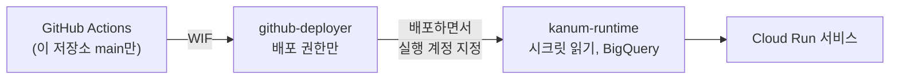
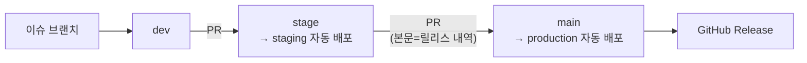

+++
title = "수업에서 배운 배포를 실제 서비스에 붙이기: GitHub Actions부터 무중단 배포까지"
date = "2026-10-30T14:00:00+09:00"
draft = false
tags = ["cloud-run", "github-actions", "무중단-배포", "블루그린", "wif", "staging", "kanum", "회고"]
categories = ["일지"]
description = "배포는 늘 남의 일이었다. 교안 템플릿 대신 운영 중인 서비스에 수업 네 개를 연달아 붙이면서, 리비전과 트래픽을 처음 직접 다뤄 봤다."
+++

# 수업에서 배운 배포를 실제 서비스에 붙이기

> 배포 직후 QA가 서로 다른 버전을 보고 "안 고쳐졌다"고 하던 장면이, 리비전과 트래픽을 직접 나눠 보고 나서야 이해됐다.

---

## 들어가며

[1편](/blog/kanum-9-days-10-releases/)에서 AI 리터러시 서비스 가늠을 만든 이야기를 했다. 이 글은 같은 기간에 그 서비스에 배포를 붙인 이야기다.

"AI 서비스 인 프로덕션" 수업에서 배포 단원을 연달아 배우고 있다.

1. GitHub Actions로 자동 배포하기
2. Staging (테스트, staging/production 분리, 브랜치 보호)
3. 로드밸런서로 무중단 배포 구성 (Nginx 블루그린, 로컬)
4. Cloud Run으로 무중단 배포하기

사실 이 수업엔 실습 템플릿이 있었다. 하지만 나는 원래 교안대로 하는 걸 좋아하지 않는 편이다.

<figure></figure>

마침 실제 Claude API를 붙이고 GCP까지 연결해서 배포하는 실습이었으니, 이왕 할 거 내가 만들고 싶던 서비스로 하는 게 이득이라고 생각했다. 대신 처음부터 규모를 키우지 않으려고 POC로 시작했고, 그 뒤로 배포 수업이 나올 때마다 같은 서비스에 붙였다.

솔직히 나에게 있어 배포는 늘 남의 일이었다. 개발자로 일하면서 간단한 CI/CD는 해 봤지만, 클라우드에 연결해 리비전을 신경 쓰고 배포 파이프라인부터 staging, 실배포까지 처음부터 끝까지 맡아 본 적은 없었다. 그런 일은 대부분 백엔드 개발자나 배포 담당자가 따로 하기도 했고 몸담았던 서비스들에서 무중단 배포를 하는 경우도 거의 없었다.

| 항목 | 가늠 |
|---|---|
| 플랫폼 | Cloud Run (us-central1), 소스 배포(빌드팩, Dockerfile 없음) |
| 서비스 | production, staging 2개 |
| 인증 | WIF (서비스 계정 키 파일 없음) |
| 규모 | 1인 운영, 테스터 소수 |

이 글에는 배포 용어가 많이 나온다. 서비스를 푸드코트에 빗대 먼저 정리해 둔다. 손님은 사용자 요청이고, 매장은 서버에 올라간 버전이다.

| 용어 | 쉬운 말 | 푸드코트로 보면 |
|---|---|---|
| 리비전 | 배포할 때마다 새로 생기는 버전 한 벌 | 새로 차린 매장. 옛 매장도 바로 철거하지 않고 남겨 둔다 |
| 트래픽 | 사용자 요청을 어느 버전으로 몇 %씩 보낼지 | 입구 안내 직원이 손님을 어느 매장으로 보낼지 |
| 0% 배포 | 새 버전을 올려 두되 요청은 하나도 보내지 않음 | 새 매장을 다 차려 놓고 간판 불은 아직 안 켠 상태 |
| 태그 URL | 특정 버전으로만 바로 가는 주소 | 직원 전용 뒷문. 손님 없이 새 매장에 들어가 볼 수 있다 |
| 스모크 테스트 | 바꾸기 직전 핵심 기능만 빠르게 확인 | 오픈 전 시식 |
| 롤백 | 이전 버전으로 되돌리기 | 안내를 다시 옛 매장으로 돌림 |
| 블루그린 / 카나리 | 한 번에 전부 옮기기 / 일부만 먼저 옮겨 보기 | 손님 전체를 새 매장으로 한 번에 / 손님 10%만 먼저 새 매장으로 |
| 무상태 | 서버 안에 기억을 두지 않음 | 주문 기록을 매장 수첩이 아니라 푸드코트 공용 주문 시스템에 둠. 매장을 바꿔도 주문이 사라지지 않는다 |

---

## 1. GitHub Actions: 템플릿 대신 이유를 옮겼다

교안 템플릿에는 starter 폴더, WIF 설정 문서, 장애 재현용 패치 같은 전용 파일이 있었다. 가늠에는 그런 파일이 없으니 템플릿을 그대로 쓸 수 없었다. 그래서 각 단계가 왜 있는지를 보고 가늠에 맞는 것만 옮겼다.

### 서비스 계정을 둘로 나눴다

서비스 계정은 사람이 아니라 프로그램이 GCP에서 쓰는 계정이다. 푸드코트로 치면 직원 출입증인데, 매장을 새로 차리는 공사 담당 출입증과 매장에서 일하는 직원 출입증을 따로 만든 셈이다.

배포하는 계정과 서비스가 실행되는 계정을 나눴다. `github-deployer`는 배포만 할 수 있는 계정이다. WIF 공급자에 `assertion.repository=='chictimin/kanum-session-review'` 조건을 걸어서, 이 저장소에서 온 요청만 이 계정을 쓸 수 있게 했다. WIF는 GitHub Actions가 비밀 키 파일을 들고 다니지 않고, 실행될 때마다 "GitHub의 이 저장소에서 온 요청"이라는 확인을 받아 이 계정을 잠깐 빌려 쓰는 방식이다. 키 파일이 없으니 유출될 것도 없다. `kanum-runtime`은 서비스가 돌 때 쓰는 계정이고, 시크릿 3개를 읽는 권한과 BigQuery 권한만 줬다. 그동안 서비스가 쓰던 기본 compute 계정에서는 시크릿과 BigQuery 권한을 회수했다.

### 교안과 다르게 한 것: 빌드용 계정은 안 만들었다

교안은 빌드용 서비스 계정도 따로 만들라고 했다. 이유는 "기본 compute 계정에 Editor 권한이 있어서 위험하다"였다. 가늠 프로젝트의 기본 계정을 확인해 보니 Editor 권한이 없었다. 근거가 해당하지 않으니 만들지 않았다.

템플릿을 그대로 따라 했다면 필요 없는 계정이 하나 더 생겼을 것이다. 단계마다 "이건 무엇을 막으려고 있는가"를 확인한 덕분에 덜어 낼 수 있었다.

### 추가 과제

과제 1로는 `GET /api/version`을 만들었다. 현재 커밋 SHA를 돌려주고, 메뉴 하단에 7자리로 표시한다. 커밋 SHA는 비밀이 아니라서 토큰 없이 열었다. 이 엔드포인트는 나중에 무중단 배포를 측정할 때 다시 쓰인다.

과제 3으로는 감사 로그(GCP에서 누가 무엇을 했는지 남는 기록)를 확인했다. 자동 배포는 `github-deployer`와 `repo:...:ref:refs/heads/main` 위임 정보로 남고, 수동 배포는 개인 계정으로만 남는다. 누가 배포했는지가 로그에서 갈린다.

### 겪은 것

서비스 계정을 만든 직후 IAM 바인딩이 "does not exist"로 실패했다. 전파 지연이었고, 잠시 뒤 다시 실행하니 됐다.

Claude Code 자동 모드가 IAM 권한 부여와 PR 머지를 막기도 했다. 권한 부여는 내가 직접 실행했고 머지도 내가 했다. 실서버 배포 권한 같은 일은 에이전트가 못 하게 막혀 있는 편이 맞다고 생각한다.

---

## 2. Staging: 브랜치가 곧 환경이 됐다

staging 수업 뒤에 구조가 이렇게 됐다.

### 브랜치 보호는 못 걸었다

교안은 main에 브랜치 보호(또는 Rulesets)를 걸어 CI 통과를 필수로 만들라고 했다.
그런데 GitHub Free 플랜은 다들 알다시피 private 저장소에서는 둘 다 쓸 수 없다. 혹시 몰라 API를 호출해봤지만 그들에게서 돌아온 것은 "Upgrade to GitHub Pro or make this repository public"이란 메시지뿐이었다.

<figure><figcaption>기능은... 돈으로 살 수 없다. 왜냐면 돈이 없으니까!</figcaption></figure>

그래서 배포 쪽에서 막았다. staging과 production 배포 잡 모두 CI 잡을 먼저 호출하고, 통과해야만 배포한다. 머지 자체는 막지 못하지만, 테스트가 깨진 코드가 서버에 올라가지는 않는다.

### `--set-secrets` 함정

staging 첫 배포가 실패했다. 원인은 시크릿(API 토큰처럼 코드에 직접 적으면 안 되는 값)을 서비스에 연결하는 `--set-secrets` 옵션이었다. 이름만 보면 시크릿을 추가하는 옵션 같은데, 실제로는 서비스의 시크릿 연결 전체를 교체한다. 콘솔에서 넣어 둔 토큰이 지워졌다. 그 뒤로는 추가할 때 항상 `--update-secrets`를 쓰고, production 잡에서는 시크릿을 아예 지정하지 않아 기존 연결을 그대로 둔다.

---

## 3. 로드밸런서 수업: 개념만 가져왔다

이 수업은 Nginx로 블루그린을 직접 구성하는 로컬 실습이었다. 실습은 에이전트에게 맡겨 돌려 보고 넘겼다. Cloud Run 앞에 Nginx와 컨테이너를 따로 두는 구조는 이 서비스와 맞지 않는다고 봤기 때문이다. 웹앱 규모도 작고, 혼자 개발하고 운영하며, 트래픽도 하루 수십 건 수준이다. 이런 서비스에 로드밸런서와 컨테이너를 직접 관리하는 층을 하나 더 얹는 건 얻는 것보다 관리 부담이 더 큰 오버헤드라고 판단했다.

가져온 건 미리 띄워서 확인하고, 전환하고, 문제가 있으면 되돌린다는 개념뿐이다. 이 개념은 다음 수업에서 Cloud Run 방식으로 구현했다.

---

## 4. Cloud Run 무중단 배포: 먼저 점검하고, 그다음 붙였다

### 바로 구현하지 않고 먼저 대 봤다

교안 항목을 가늠에 하나씩 대 보고, 어디까지 이미 돼 있는지 읽기 전용으로 점검했다.

| 교안 항목 | 가늠 상태 |
|---|---|
| 리비전·트래픽 | 적용됨 (이전 리비전 유지, 손으로 되돌리기 가능) |
| 무상태화 | 적용됨 (판 상태를 브라우저가 들고 매 턴 서버로 보냄) |
| 0% 배포 + 태그 URL | 미적용 (머지하면 바로 100%) |
| 원클릭 롤백 | 미적용 |
| 스타트업 프로브 HTTP화 | 미적용 (TCP 기본값) |
| 카나리, 승인 단계 | 미적용 |

점검하면서 하나 깨달았다. "무중단"은 이미 기본값이었다. Cloud Run은 새 리비전이 준비된 뒤에 트래픽을 옮긴다. 실습이 더해 주는 건 "끊기지 않음"이 아니라, 망가진 버전을 사용자 앞에 세우기 전에 거르는 단계다.

서비스(가늠)에서 진짜 위험한 건 기동은 되는데 로직이 망가진 버전이었다. 아예 안 뜨는 버전은 포트를 열기 전에 죽으니까 기본 TCP 프로브로도 걸러진다. 스타트업 프로브는 새 버전이 요청을 받을 준비가 됐는지 Cloud Run이 확인하는 검사인데, 기본값인 TCP 방식은 포트가 열렸는지만 본다. 매장 문이 열렸는지만 보고 음식 맛은 보지 않는 셈이다.

### 리비전과 트래픽을 나눠서 보기

이 수업에서 가장 크게 와닿은 건 리비전과 트래픽을 따로 본다는 개념이었다. 배워서 알고는 있었지만 직접 다뤄 본 적이 없어서 막연하게만 알던 것이다.

Cloud Run에서는 새 버전을 올리는 것(리비전 생성)과 사용자 요청을 그 버전으로 보내는 것(트래픽 전환)이 별개다. 새 리비전을 트래픽 0%로 올려 두고, 태그 URL로 그 리비전만 따로 찔러 볼 수 있다. 확인이 끝나면 트래픽을 옮기고, 문제가 생기면 이전 리비전으로 다시 옮긴다.

### 붙인 것: 6단계

`deploy.yml`의 staging과 production 잡에 같은 단계를 넣었다. 서버 코드와 웹 코드는 하나도 안 바꿨다.

1. 새 리비전을 `candidate` 태그와 함께 트래픽 0%로 올린다.
2. `candidate` 태그가 정확히 1개인지, 그 리비전의 커밋이 이번 커밋인지, 기존 리비전이 여전히 100%인지 확인한다.
3. 태그 URL로 스모크 테스트를 한다. `/api/version`의 커밋 40자가 맞는지, `/`가 HTML을 주는지, 토큰 없는 요청이 401로 막히는지 본다. 모델 호출은 하지 않는다.
4. `update-traffic --to-latest`로 트래픽을 옮기고, 직전 리비전에 `previous` 태그를 붙인다.
5. 기본 URL의 커밋이 3번 연속 일치하는지 본다.
6. 단계별 소요 시간을 요약으로 남긴다.

<figure></figure>

3단계가 바로 오픈 전 시식이다. 손님 앞에 내놓기 전에 직원 전용 뒷문으로 들어가 먼저 맛을 본다. 여기서 이상하면 간판 불을 켜지 않는다.

전환을 `--to-tags`로 끝내지 않은 건 교안에서 배운 함정 때문이다. 태그로 100%를 주면 트래픽이 그 리비전에 고정돼서, 다음 배포가 트래픽을 받지 못한다.

되돌리기는 `rollback.yml`(수동 실행 버튼)로 따로 만들었다.

### 측정: 버전이 섞이는지를 따로 셌다

예전 현장에서 배포 날에 이런 일을 자주 봤다. 배포 직후 QA를 돌리는데, 한 사람은 새 버전을 보고 다른 사람은 이전 버전을 보고 있었다. 그래서 고친 걸 "안 고쳐졌다"고 오판하는 일이 많았다.

그래서 측정에서는 요청이 성공했는지만큼이나 버전이 섞이는지를 중요하게 봤다. 교안의 측정 스크립트 스펙(200ms 간격으로 `/api/version` 폴링, 버전 섞임, p95)을 그대로 따라 Node로 다시 짰다. 배포가 진행되는 동안 계속 요청을 쏘면서, 실패한 요청 수와 구버전·신버전이 섞여 응답한 구간, 전환이 끝난 뒤 구버전이 다시 나타난 횟수를 센다.

| 시나리오 | 요청 성공 | 오류 |
|---|---|---|
| 스모크 실패 주입 → 전환 안 됨 | 2364/2364 | 0 |
| staging 정상 배포 | 2721/2721 | 0 |
| 명시 리비전으로 롤백 | 959/959 | 0 |
| 배포 + 자동 롤백 | 2871/2871 | 0 |
| production 첫 배포 | 2678/2678 | 0 |

측정한 모든 회차에서 요청 오류는 0건이었다. 버전 섞임은 staging 회차에서 0이었고, production 첫 배포에서는 0.209초 동안 섞였다. 전환 뒤 구버전 재등장도 0이었다. 일부러 롤백한 회차만 예외인데, 이건 되돌리기가 의도대로 구버전을 다시 세운 것이다. p95(요청 100개를 빠른 순으로 줄 세웠을 때 95번째 응답 시간)는 219~244ms였다.

### 실 staging에서만 나온 결함 3개

로컬 테스트와 가짜 데이터(fixture)로는 다 통과했는데, 실제 staging에서 세 개가 나왔다.

첫 번째는 GCP가 트래픽 항목을 합쳐서 돌려준다는 점이었다. 정상 배포 뒤 `status.traffic`(Cloud Run이 알려 주는 현재 트래픽 배분표)을 보면, 같은 리비전의 100% 항목과 `candidate` 태그 항목이 하나로 합쳐져 내려온다. 현재 서빙 중인 리비전을 태그 없는 항목에서 찾던 코드는 아무것도 찾지 못했고, 자동 롤백이 "서빙 중인 리비전을 특정할 수 없음"으로 멈췄다. 가짜 fixture가 실제 응답 모양과 달랐던 게 근본 원인이었다. 리비전 이름별로 퍼센트를 합산하는 방식으로 고쳤다.

두 번째는 롤백이 한 번도 서빙된 적 없는 리비전을 고른 것이다. 자동 롤백은 생성 시각상 바로 앞 리비전을 골랐는데, 그 리비전은 스모크에서 떨어져 트래픽을 받은 적이 없었다. 그래서 전환에 성공할 때만 직전 리비전에 `previous` 태그를 붙이고, 롤백은 그 태그만 보게 바꿨다. 실패한 후보에는 `previous`가 붙지 않으니 구조적으로 고를 수가 없다.

세 번째는 비율은 같은데 모양이 달라서 막힌 경우다. 롤백 전후로 트래픽 비율이 바뀌지 않았는지 확인하는 단계가 문자열 비교였다. 태그를 하나 붙이면 합쳐져 있던 항목이 나뉘면서 문자열이 달라진다. 비율은 그대로인데 "바뀌었다"며 롤백을 막았다. 첫 번째와 같은 합산 방식으로 통일했다.

세 개 모두 GCP가 실제로 어떤 모양의 데이터를 주는지 모르고 짠 코드에서 나왔다. 교안 실습은 처음부터 끝까지 한 번에 도니까 이런 상태 조합이 안 나온다. 실패를 일부러 주입하고, 연속으로 배포하고, 롤백까지 해 봐야 나온다. 다행히 세 경우 모두 트래픽을 건드리지 않는 쪽으로 멈췄다.

### 함정 하나 더: 버튼 워크플로는 main에 있어야 한다

`rollback.yml`을 stage 브랜치에서 먼저 시험하려 했는데 실행하자마자 404가 났다. `workflow_dispatch`(수동 실행) 워크플로는 기본 브랜치에 있어야 실행된다. main에 머지한 뒤에야 버튼이 열렸다.

---

## 일부러 안 한 것

| 교안 항목 | 안 한 이유 |
|---|---|
| 카나리 | 요청이 하루 수십 건 규모라 10% 구간에서 오류율이나 p95가 쌓이지 않는다. 블루그린이 맞다 |
| 승인 단계 | 팀이 여러 번 배포하는 상황을 전제로 한다. 1인 운영이면 매번 버튼만 늘어난다 |
| 스타트업 프로브 HTTP화 | 기동이 동기적이고 빨라서 효과가 작다. 스모크 3검사가 그 역할을 한다 |

아래 그림은 결함이 있는 새 매장을 세 가지 방식으로 열었을 때를 비교한 것이다. 같은 시각에 결함을 발견해도, 방식마다 오류를 본 손님 수가 다르다.

빌드용 계정, 카나리, 승인 단계는 가늠에 막을 위험이 없어서 뺐다. 반대로 `previous` 태그와 합산 판정은 교안에 없었지만 실제 staging이 요구해서 더했다. 교안의 각 단계는 "이걸 하라"가 아니라 "이 위험을 막아라"였다.

### 대가

배포 시간이 늘었다. 변경 전 production은 평균 168초였는데, 변경 뒤 첫 production 배포는 약 418초였다. staging은 평균 186초에서 199~381초가 됐다. 대신 단계별 소요 시간이 매번 남는다. Actions 과금 시간은 전후 모두 0이었다.

### 남은 한계

긴 요청은 검증하지 않았다. 측정은 짧은 `/api/version`만 쐈기 때문에, LLM 호출처럼 수십 초 걸리는 요청이 전환 순간에 어떻게 되는지는 이 측정으로 증명되지 않는다.

production 롤백도 실제로 실행하지는 않았다. staging에서 검증하고, production은 수동 절차를 문서로 남겨 두었다.

---

## 마치며

무중단 배포를 붙인 날, production에 여섯 번 나갔다.

배포는 늘 남의 일이었고, 무중단 배포는 해 본 적도 없었다. 리비전과 트래픽을 직접 나눠 보고 나서야 막연하던 개념이 손에 잡혔다.

그리고 왜 다들 실배포 날에 그렇게 긴장했는지 확실히 알게 됐다. 버전을 잘못 올려 급하게 롤백하던 일, 올린 버전에서 뒤늦게 문제가 터져 핫픽스를 덧붙이던 일, 작은 코드 실수 하나로 장애가 나서 시말서를 쓰던 분까지 봤다. 그때는 결과만 봤는데, 이번에 직접 해 보니 그 장애들이 어느 틈에서 일어났을지가 구체적으로 그려졌다. QA끼리 서로 다른 버전을 보던 것도 결국 트래픽이 어느 리비전으로 가고 있는지 아무도 보고 있지 않았기 때문이다.

---

## 참고 자료

- Cloud Run 롤백·점진 배포·트래픽 전환: [Google Cloud 문서](https://cloud.google.com/run/docs/rollouts-rollbacks-traffic-migration)
- GitHub Actions `workflow_dispatch`: [GitHub 문서](https://docs.github.com/en/actions/writing-workflows/choosing-when-your-workflow-runs/events-that-trigger-workflows#workflow_dispatch)
- `google-github-actions/deploy-cloudrun`: [GitHub 저장소](https://github.com/google-github-actions/deploy-cloudrun)
- 1편: [9일, 릴리스 10번: AI한테 말 거는 연습장을 만들기까지](/blog/kanum-9-days-10-releases/)
