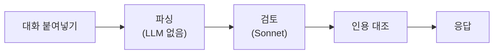

+++
title = "9일, 릴리스 10번: AI한테 말 거는 연습장을 만들기까지"
date = "2026-10-29T21:00:00+09:00"
draft = false
tags = ["kanum", "ai-literacy", "연습장", "claude-code", "cloud-run", "회고"]
categories = ["일지"]
description = "AI 리터러시 서비스 가늠을 9일 동안 만들었다. 가장 크게 막혔던 건 AI가 자꾸 '확인해 주세요'로 대화를 끝내는 문제였다."
+++

# 9일, 릴리스 10번: AI한테 말 거는 연습장을 만들기까지

> AI가 "확인해 주세요"로 대화를 끝낼 때마다 지시문을 고쳤다. 답은 확인할 거리를 문제 안에 넣어 주는 쪽에 있었다.

---

## 들어가며

이번에 **가늠**이라는 서비스를 하나 만들었다. 가늠은 AI가 답을 떠먹여 주는 대신, AI와 대화하면서 스스로 헤아려 판단하는 힘을 기르게 하는 AI 리터러시 서비스다. 이름도 "가늠하다(스스로 헤아려 판단하다)"에서 따왔다. 오늘은 이걸 만든 계기와 만든 과정을 좀 풀어 보려고 한다.

계기는 엄마였다. 엄마는 올해 대학에 입학하셨다. 원래도 일상에서 AI를 가끔 쓰시긴 했는데, 대학 생활을 시작하시고 나서는 AI를 쓰실 수밖에 없는 환경이 됐다. 스터디 그룹에서도 AI 얘기가 많이 나오고, 수업에서도 과제에 AI를 쓸 때의 주의점이나 AI로 공부하는 법이 자주 언급됐다.

과제를 다듬고 글을 쓰는 데 AI 도움을 많이 받으셨다고는 했다. 그런데 이런 말씀도 하셨다.

- 뭘 물어봐야 할지 막막하다.
- 물어봐도 이게 맞는 건지 계속 고민하게 된다.

여기에 학교에서 "AI를 어디에 어떻게 썼는지 꼭 밝혀라", "AI 써서 0점 받은 사람도 있다더라" 같은 얘기를 들으시면서 막연한 공포까지 느끼셨다. 거기다 부트캠프를 다니면서 보니 비슷한 고민을 가진 사람이 꽤 많았었다.

그때 AI 리터러시를 키우는 서비스가 하나쯤 있었으면 좋겠다는 생각에 러프하게 아이디어를 따로 적어두었다(아마 부트캠프 초기에 썼던 걸로 기억한다).

<figure></figure>

그러던 중 최근 수업에서 실제 Claude API를 붙이고 GCP에 배포까지 하는 실습을 하게 되었고, 어차피 할 실습이면 내가 만들고 싶은 서비스를 만드는 게 낫다고 생각해서 아이디어를 구체화했다.

지금 가늠에 구현된 기능은 두 가지다.

하나는 AI와 나눈 대화를 넣으면 대화 습관을 짚어 주는 세션 검토이고, 다른 하나는 카드에 적힌 상황을 그 상황을 모르는 AI한테 설명해서 필요한 답을 얻어 내는 연습장이다. 이 중 구현이 비교적 가벼운 세션 검토를 먼저 POC로 만들고, 그 뒤에 주요 기능인 연습장을 차근차근 쌓아 올렸다.

| 항목 | 값 |
|---|---|
| 기간 | 10-21 ~ 10-29 (작업한 날 6일) |
| GitHub Release | 10개 |
| GitHub 이슈 | 71개 |

같은 기간에 수업에서 배운 배포(GitHub Actions, staging, 무중단 배포)를 이 서비스에 그대로 붙였는데, 그 이야기는 2편에 따로 적는다. 이 글은 가늠을 만든 이야기다.

---

## 1. 하루짜리 POC: 세션 검토

실습 첫날, 하루 안에 서비스를 만들어 배포까지 해 보기로 목표를 잡았다. 이 일정을 맞춰야 해서 비교적 가벼운 세션 검토 기능을 만들었다. 구조는 단순하다.

이 기능은 일반 사용자와 코딩 에이전트 도구를 쓰는 사람 모두 쓸 수 있게 기획했다. 일반 사용자는 대부분 대화형 챗봇을 쓰고, 거기서 나눈 대화를 복사해 붙여 넣는 게 가장 자연스러운 흐름이다. 그래서 붙여넣기에 먼저 공을 들였다.

문제는 붙여 넣은 대화에서 누가 한 말인지 나누는 일이었다. 텍스트로 복사한 대화에는 역할 표시가 없어서, 사용자 메시지 48개 중 9개만 사용자 것으로 인식했다. 클립보드에 텍스트와 함께 담기는 HTML을 읽게 바꿨더니 claude.ai와 ChatGPT 모두 역할 속성이 붙어 있었고, 그걸로 정확히 나눌 수 있었다. 역할이 제대로 나뉘고 나니 검토 결과가 원문을 인용할 때 엉뚱한 턴을 짚는 문제도 함께 바로잡을 수 있었다.

내가 예전에 실수했고 나중에 규칙까지 만든 세션을 넣어 봤다. 검토기가 그 실수 두 건을 따로 짚어 냈다. 하루 만에 실서버 리비전 12까지 갔고, POC는 "검증됨"으로 판정했다.

---

## 2. 연습장 설계: 두 가지 말을 두 단계로

다음 날 주요 기능인 연습장의 첫 게임을 기획했다. AI를 막 쓰기 시작한 사람들에게서 들은 두 가지 말이 그대로 두 단계가 됐다.

| 사람들이 하는 말 | 연습장 |
|---|---|
| 뭘 물어봐야 할지 막막하다 | 1단계: 상황을 말해야 답이 열리는 카드 |
| 이게 맞는 건지 계속 고민된다 | 2단계: AI가 틀린 답을 하면 알아채고 짚는 카드(거짓 분별) |

1단계 규칙은 이렇다.

> 사용자는 **상황은 알고 답은 모른다**. 카드(메신저 대화록 + 오류 원문)를 보고, 카드를 모르는 평범한 AI와 대화해서 AI 답에 해결에 필요한 요소가 다 나오게 하면 승리. 최대 8턴.

용어 정의만 물으면 일반론만 돌아오고, 내 상황을 말해야 필요한 답이 열린다. 막막해서 "이게 뭐예요?"만 묻게 되는 습관을 "지금 이런 상황인데"로 바꾸는 연습이다.

이날 아이디어, 유저 플로우, PRD, 카드 5장까지 만들었다. 상대 AI, 판정관, 플레이어를 전부 `claude -p`로 띄워 사전 점검도 세 번 돌렸다. AI 에이전트끼리 플레이해 본 것이다.

---

## 3. 가장 큰 막힘: "확인해 주세요"

그렇게 만들어진 초안을 직접 플레이해 보니 예상치 못한 큰 문제가 보였다.
**바로 상대 AI가 자꾸 확인을 요구한다는 것.**

AI는 기본적으로 눈앞의 상황을 해결하는 걸 우선하게 짜여 있다. 틀린 정보를 줄이려고 지금 상황에 대한 정보를 최대한 캐내려 한다. "설정 화면 캡처를 보여 주실 수 있나요?", "오류 메시지 전문을 확인해 주세요" 같은 말이 나온다. 그런데 카드에는 플레이어가 보여 줄 수 있는 자료가 없다. 대화가 잘 흘러가다가도 결국 "확인해 주세요"로 끝나 버렸다.

처음에는 지시문으로 막으려 했다. 확인을 요구하지 말라고 적었다. 그런데 이건 AI가 움직이는 중심축이자 목적과 어긋나는 요구다. 지시문을 고쳐도 잘 나가다가 다시 "확인해 주세요"로 끝맺었다.

<figure></figure>

어떻게 해결해야 하나 잠깐 고민하다 생각을 바꾸었다. 뭘 자꾸 보여 달라고 한다면 그 보여 달라는 걸 그냥 만들어 주자. 어차피 이건 그런 상황을 가정하고 푸는 '문제'다. 그 문제의 증거도 우리가 만들어서 같이 넣으면 된다.

그래서 플레이 흐름이 이렇게 바뀌었다. 대화 중에 AI가 화면이나 자료를 보여 달라고 하면, 그 자료가 화면 옆에 바로 추가된다. 플레이어는 그 자료를 보고 AI에게 다시 설명하면서 대화를 이어 간다.

구조를 바꾸고 나니 "확인해 주세요"에 막혀 있던 판들이 모두 뚫렸다.

바꾼 구조로 플레이해 보니 하나 더 나아진 점이 있었다. 실제 사람들이 겪는 상황과 훨씬 비슷하게 느껴진다는 점이었다. 현실에서도 사람들은 AI한테 스크린샷이나 오류 메시지, 안내문을 보여 주면서 묻는다. 확인 요청에 자료로 답하는 흐름이 게임 장치이면서, 그 자체로 연습해야 할 행동이 됐다.

---

## 4. 정밀성에 매달리는 에이전트

앞서 정한 방식대로 증거를 만들기 시작하니 이거 문제가 또 생겼다. 카드와 자료를 쓰는 에이전트들이 이젠 "오차가 있으면 안 된다"에 맹목적으로 매달리기 시작한 것이다.

- 실제 오류 메시지가 정확히 어떻게 뜨는지 대조해 봐야 합니다.
- 어떤 OS를 쓴다고 가정하고 진행할까요? 윈도우라면 이런 오류 모양이 나옵니다.
- 실제 서비스되고 있는 앱 중 어떤 걸로 측정할까요?
- 실제 애플리케이션의 UI와 증거의 문구가 일치하는지 확인해야 합니다. (심지어 다국어 메시지까지 검토하고 있었다.)

문제의 흐름과 핵심 요소를 강화하는 데 힘을 써야 하건만 방향이 이쪽으로 샜다.

또 엉뚱한 곳에 빠져드는구나 싶어서 **이건 흐름과 맥락이 중요하지, 실제와 똑같을 필요는 없다**고 잔소리를 할 수밖에 없었다.

이 기준은 원칙으로 남았다. 자료는 연습이 성립하는 최소한까지만 재현하고, 정밀하게 재현하는 데 비용을 쓰지 않는다. 실제 브랜드나 제품 이름도 쓰지 않는다. 가상의 세계로 두면 실제 UI나 문구와 맞출 필요가 없고, 기종이나 제품에 따라 답이 달라지는 문제도 애초에 내지 않게 된다.

정리하면 두 가지를 구분하게 됐다. 자료를 얼마나 정밀하게 재현하느냐는 최소한으로 두고, 자료를 보여 주며 묻는다는 상황의 구조는 현실과 똑같이 둔다.

---

## 5. 같은 원리를 일상 카드에

연습장을 가늠의 주요 기능으로 굳히면서, 세션 검토는 연습장 커리큘럼을 만들 때 쓰는 1차 분석 도구로 자리를 잡았다.

이때 코딩 문제 말고 일상 영역 카드를 만들었다. 일반 사람들이 실제로 부딪히는 상황이 필요했다. 소재를 고르면서 원칙이 하나 더 생겼다.

> 실생활 규범(법·의료·약·세금·금융)과 충돌하는 소재는 쓰지 않는다. 정답 기준이 그 문서 자체인 소재만 쓴다.

거짓 분별을 연습하려면 무엇이 정답인지가 카드 안에서 닫혀 있어야 한다. 세금이나 약은 정답이 카드 밖 현실에 있어서 연습장이 책임질 수 없다. 그래서 동호회 회칙, 관리사무소 안내문, 아파트 분리수거 규정처럼 그 문서가 곧 기준인 소재로 갔다.

그런데 새 일상 카드를 직접 플레이해 보니 3절과 같은 문제가 다른 모양으로 나왔다. 관리사무소 안내 같은 기관 문서를 AI가 확인을 요청해야 열리는 숨은 자료로 뒀더니, "AI한테 특정 기관의 내부 정보를 묻는다"는 비현실적인 전제가 됐다. 전제가 이렇다 보니 플레이어도 뭘 물어야 할지 몰랐다.

그래서 **사용자가 안내문을 이미 채팅에 첨부해서 보낸 상태로 판을 시작**하도록 구조를 바꾸었다. 그런데 에이전트들은 이걸 또 멋대로 "안내문을 이미 알고 있는 AI 도우미"(예를 들면 아파트 공고문 안내 도우미)를 등장시키는 방향으로 해석하고 진행하고 있었다. 내가 생각한 건 그게 아니었다. 사람들이 실제로 하는 건 평범한 AI에게 파일을 첨부해서 묻는 것이니, 그 설정을 바로잡았다.

<figure><figcaption>아오 그만 좀 헛다리 짚어라</figcaption></figure>

그 뒤로 카드를 다듬는 일은 내가 직접 플레이하면서 하기로 했다.

---

## 6. 두 번째 단계: 거짓 분별

"이게 맞는 건지 계속 고민된다"에 해당하는 2단계도 만들기 시작했다. AI가 틀린 답을 했을 때 플레이어가 자료와 대조해서 알아채고 짚는지 보는 카드다.

1단계와는 판을 끝내는 방식이 다르다. 포기 버튼 대신 "확인 끝났어요" 버튼을 두어, 내가 확인을 마쳤다고 선언하면서 판을 끝낸다. 그리고 4장 중 1장꼴로는 AI가 맞게 답하는 카드를 섞었다. 무조건 의심만 하면 이기는 게임이 되면 안 되기 때문이다. 판정관 지시문은 Haiku로 132회 시험해서 118회(89%)가 기대와 일치했고, 틀린 유형을 보고 한 번 더 고쳤다.

카드 4장을 직접 다 플레이해 봤는데 전반적으로 쉬웠다. 공동구매 카드 정도로 함정이 적당히 깔린 것을 난도 기준으로 잡았다.

---

## 릴리스 흐름

| 날짜 | 릴리스 | 연습장 쪽 주요 내용 |
|---|---|---|
| 10-23 | 3개 | 확인 자료, 문제 세계, 판정 기준 완화, 판 임시저장 |
| 10-28 | 1개 | 연습장 화면 다듬기, 푸터 릴리스 버전 |
| 10-29 | 6개 | 일상 영역, 첨부 카드, 자료 그림과 모달, 업데이트 소식 페이지, 영역 돌아가기 핫픽스 |

마지막 날 하루에 여섯 번 나갈 수 있었던 건 같은 날 붙인 무중단 배포 덕도 있는데, 그 얘기는 2편에서 한다.

---

## 마치며

다음은 **학습 영역**이다. 이유는 두 가지다.

하나는 AI를 막 쓰기 시작한 사람들이 느끼는 막연한 공포다. AI를 어디까지 써도 되는지, 쓴 걸 어떻게 밝혀야 하는지 모르니 쓰면서도 불안하다. 다른 하나는 AI에게 생각을 통째로 맡겨서, 정작 내 안에는 아무것도 남지 않는 문제다. 교재를 읽고 내 기준으로 이해했는지 확인하는 카드, 답만 받아 가는 습관을 짚는 카드를 후보로 남겨 뒀다.

9일 동안 가장 크게 배운 건 3절이었다. AI가 원래 그렇게 움직이는 걸 지시문으로 누르려 하면 계속 진다. 대신 AI가 원하는 것을 문제 안에 넣어 주면, 막힘이 풀리고 현실에도 더 가까워진다.

---

## 참고 자료

- 2편: 수업에서 배운 배포를 실제 서비스에 붙이기 (발행 예정)
- 이전 글: [작업은 에이전트가 했고, 협업은 사람이 했다](/blog/agents-did-the-work-people-still-collaborated/)
